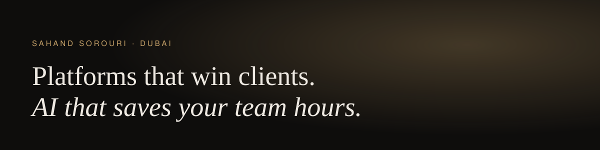

I build websites, client platforms, WhatsApp and Telegram bots and AI tools for businesses in Dubai. You get what you asked for, and the parts you will need next: tracking, follow-ups, the dashboard your team wants in month three.

**40+ tools, bots and platforms live today** · **AED 50M deal from a platform built in 5 weeks** · **7 years leading product**

[Website](https://sahand.sorouri.com) · [LinkedIn](https://linkedin.com/in/sahand-sorouri) · [WhatsApp or Telegram](https://sahand.sorouri.com/#contact) · hi@sorouri.com

## Client platforms

The code is private, so these link to the live platforms.

| Platform | What it runs |
|---|---|
| [PetGraphy](https://petgraphy.ae) | A pet photo studio: bookings, deposits, lead CRM, client galleries |
| [Prime Homes](https://primehomesabudhabi.com) | Luxury off-plan homes in Abu Dhabi: 42,690 visits, 1,518 leads, an AED 50M deal |
| [Belleview](https://belleview.ae) | Full platform for a luxury Dubai brokerage, with ads tracking |
| [Honey Deylami](https://honeydeylami.com) | Editorial site for a top Dubai broker, with a private workspace behind it |
| [HMD Attractions](https://hmdattractions.com) | Photo services for Dubai attractions, English and Arabic |
| [Hamid Moradi](https://hamidmoradi.com) | Fashion photographer and educator, 23 years behind the camera |
| [MISA Pastries](https://misapastries.com/en) | Home pastry brand with a WhatsApp basket |
| [Baked by Atie](https://bakedbyatie.com) | Custom cookies with a simple order inbox, Utah |
| [Zahra Tabar](https://zahratabar.com) | Story-led portfolio for an event facilitator |

## Open code

Personal tools, cleaned and shared so you can read how they work. Bots only answer the people their owner allows.

| Repo | What it does |
|---|---|
| [claude-usage-watch](https://github.com/sahandsorouri/claude-usage-watch) | Real Claude plan meters, pace alerts and a morning report on Telegram |
| [dictate-macos](https://github.com/sahandsorouri/dictate-macos) | Mac app: hold a key, speak, text appears at the cursor |
| [voice-to-text-bot](https://github.com/sahandsorouri/voice-to-text-bot) | Voice notes into text, on Telegram and WhatsApp |
| [telegram-merge-digest-bot](https://github.com/sahandsorouri/telegram-merge-digest-bot) | Forward many messages, get one digest grouped by author |
| [x-monitor-bot](https://github.com/sahandsorouri/x-monitor-bot) | Watches chosen X accounts and sends a digest |
| [luna-period-bot](https://github.com/sahandsorouri/luna-period-bot) | Private period tracker on Telegram, English and Persian |
| [telegram-hokm-scorer-bot](https://github.com/sahandsorouri/telegram-hokm-scorer-bot) | Hokm card game scores for group chats |
| [telegram-khayyam-quatrain-bot](https://github.com/sahandsorouri/telegram-khayyam-quatrain-bot) | A Khayyam quatrain every day |
| [nextmeeting-macos](https://github.com/sahandsorouri/nextmeeting-macos) | Menu bar countdown to your next meeting |
| [claude-usage-bar-macos](https://github.com/sahandsorouri/claude-usage-bar-macos) | First version of the usage meter, as a menu bar app |
| [flowdir-rtl-extension](https://github.com/sahandsorouri/flowdir-rtl-extension) | Fixes Persian and Arabic text direction on any site |
| [claude-ai-rtl-extension](https://github.com/sahandsorouri/claude-ai-rtl-extension) | Right-to-left fix for Claude |
| [readwise-highlights-feed](https://github.com/sahandsorouri/readwise-highlights-feed) | Book highlights as a vertical feed, [live demo](https://quotescroll.sorouri.com) |

## Background

Product manager turned builder. I used to write the specs; now I ship the product, with AI, in weeks.

- 2025 to now: independent, platforms, bots and AI tools for UAE companies
- 2024 to 2025: Nextop, crypto trading, senior product manager
- 2018 to 2023: SnappFood, product manager to Head of Product at QBAR
- 2013 to 2018: Sharif University, electrical engineering

[My story](https://sahand.sorouri.com/story/) · [Writing](https://sahand.sorouri.com/writing/) · [Resume](https://github.com/sahandsorouri/senior-pm-resume)
